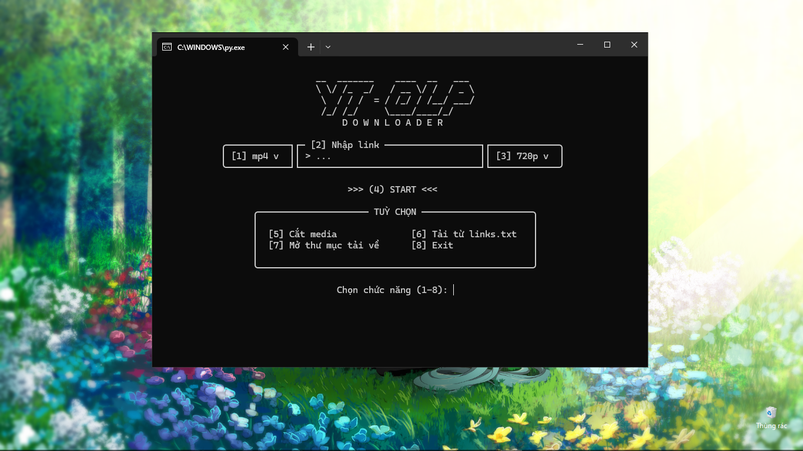
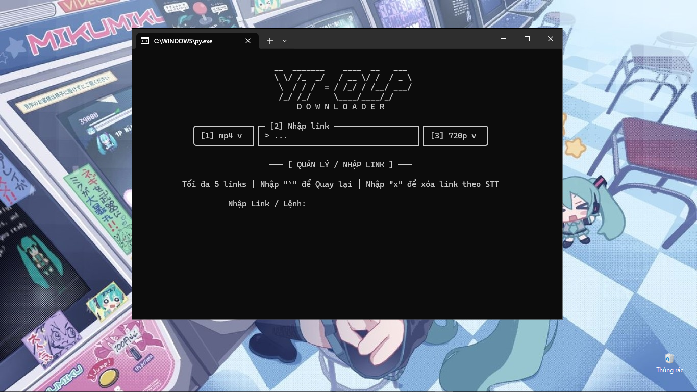
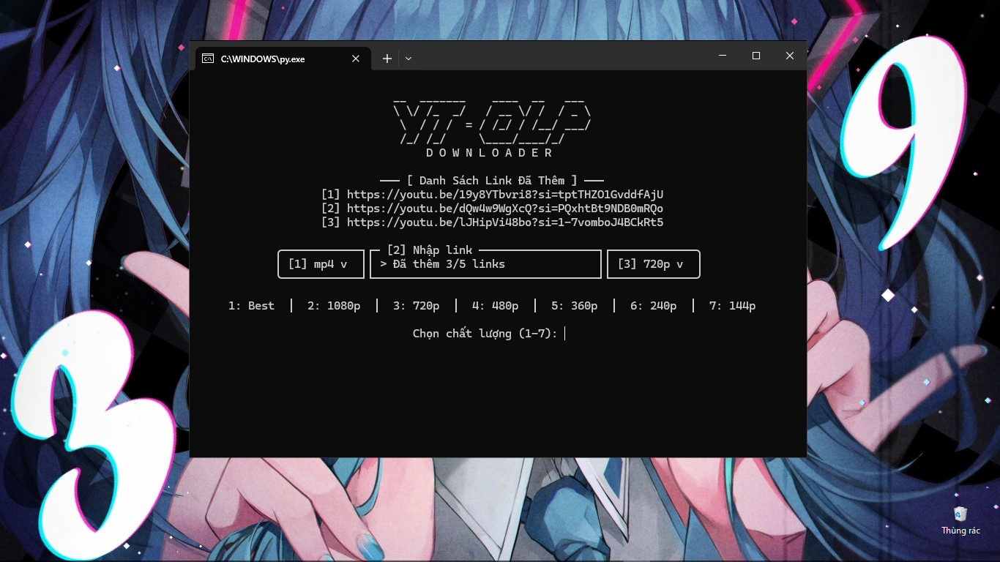
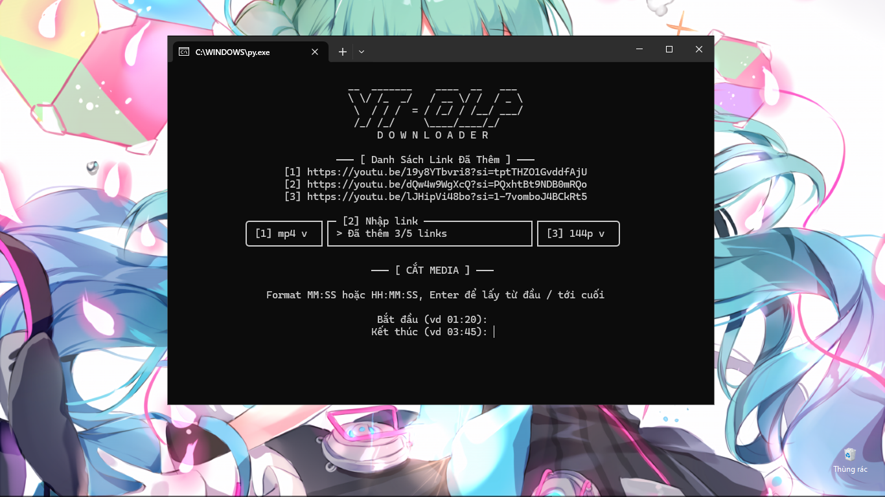
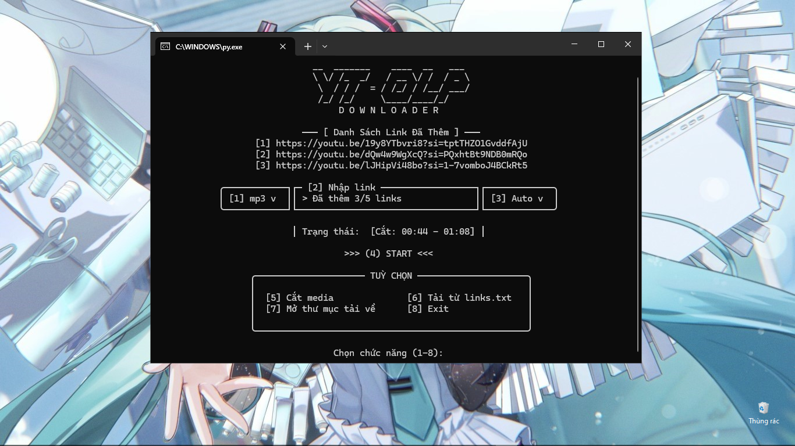

> [!CAUTION]
> * This entire README is written in Vietnamese, as my English is quite poor
> * However, I may add other languages ​​in the future if possible

> [!NOTE]
> * Tool này có sự đóng góp (chắc là khá nhiều) từ AI, nhưng không phải toàn bộ là AI mà tui cũng có đóng góp nhé
> * Tui là một coder chỉ mới học Py gần 2 tháng, nếu có lỗi gì mong ae chỉ bảo 🐧
***
```text
         __  _______    ____  __   ___   
         \ \/ /_  _/   / __ \/ /  / _ \  
          \  / / /  = / /_/ / /__/ ___/  
          /_/ /_/     \____/____/_/      
             D O W N L O A D E R 
```

# Table Of Content
   1. [Giới thiệu](#-yt-dlp-với-giao-diện-tui)
   2. [Screenshot](#-screenshot)
   3. [Tính năng](#-tính-năng)
   4. [Cách tải / sử dụng](#-cách-tải--sử-dụng)
      - [Cách tải](#-cách-tải)
      - [Cách sử dụng](#-cách-dùng)
   5. [Vấn đề đã biết](#-vấn-đề-đã-biết)
   6. [Yapping](#-yapping)


# 😋 YT-DLP với giao diện TUI


Vài một ngày đẹp trời nào đó, tôi đang tìm trang web phù hợp với mình để tải video youtube thì phát hiện [yt-dlp][1]. Quá ngon, tôi liền tải về và thử nó một thời gian thì nhận ra: yt-dlp không chỉ có download video mà còn có thể lựa chọn format, chỉnh resolution, cắt video trực tiếp, ... Nhưng với bộ não cá vàng của tôi thì việc nhớ cách dùng là không thể.

Sau đó, tôi dành khá nhiều thời gian để tìm các công cụ dùng yt-dlp có chứa các tính năng trên để sử dụng, tuy nhiên đa số đều không có, hoặc nếu có thì hoạt động quá chậm, kém hiệu quả và có lúc chả hoạt động.

Và một ý tưởng hiện ra trong đầu tôi: thay vì tìm kiếm trên mạng thì sao mình không tự làm đi nhỉ. Sau đó tôi liền bắt tay vào làm cùng con Gemini của Google. Tham khảo code, giao diện và idea từ nhiều nguồn, tôi đã tạo ra được sản phẩm như này :DD

## 📷 Screenshot
   _Nhập link_


   _Chọn quality_


   _Cắt video_


  _Kết quả_


## 🚀 Tính năng

Như đã nói ở trên thì YT-DLP downloader sẽ chứa các tính năng mà tôi muốn và có thể tiếp cận bằng yt-dlp

**Tính năng cơ bản**
- Tải media từ 1000+ các trang khác nhau
> (nó nói thế chứ tôi kbt nữa, tôi chỉ dùng để tải video youtube với facebook thôi 🐧)
- Giao diện thân thiện với ~~tôi~~ người dùng
- Cho phép chuyển đổi qua lại giữa mp3 / mp4
- Cho phép tuỳ chỉnh chất lượng video
- Các file tải về sẽ được bỏ vào thử mục "download"

**Tính năng nâng cao**
- Có thể cắt media bằng cách nhập thời gian bắt đầu / kết thúc
- Cho phép tải được nhiều file chỉ trong một lần nhấp


## 📦 Cách tải / sử dụng
### 📥 Cách tải
Bên dưới sẽ là những gì cần có và cách tải cụ thể
#### ⚠ Yêu cầu thiết yếu
Đây là những thứ cần phải có để chương trình hoạt động:
- [Python](https://www.python.org/) (v3.10+ đối với CPython / 3.11+ đối với PyPy)
- [YT-DLP][1]
- ```ffmpeg``` và ```ffprobe```
> ```YT-DLP```, ```ffmpeg``` và ```ffprobe``` đã có sẵn nên chỉ cần tải thêm Python thôi

#### 🏌️‍♀️ Installation


## 🕹 Cách dùng


# 🐞 Vấn đề đã biết


# 🗣 Yapping


[1]: https://github.com/yt-dlp/yt-dlp
